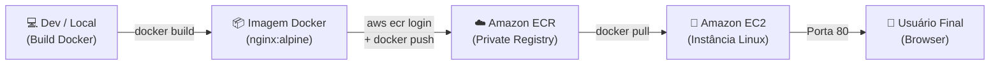

# 🌐 Containerização e Deploy de Aplicação Web com Docker & AWS ECR


> Projeto prático de DevOps focado na containerização de um website estático utilizando **Docker** e **Nginx Alpine**, gerenciamento de artefatos na nuvem com **Amazon ECR (Elastic Container Registry)** e deploy em infraestrutura **AWS EC2**.

---

## 📌 Visão Geral da Solução

O objetivo deste projeto é eliminar inconsistências entre ambientes ("na minha máquina funciona") e garantir portabilidade através da containerização. A solução empacota a aplicação web em uma imagem de alta eficiência e a distribui por meio de um registro privado corporativo na AWS.

### 🎯 Principais Destaques
- **Imagem Otimizada (Alpine Linux):** Uso de `nginx:alpine`, gerando uma imagem de apenas ~25MB (redução de mais de 80% em relação a imagens completas como Debian/Ubuntu), diminuindo a superfície de ataque e o tempo de transferência.
- **Segurança de Artefatos:** Armazenamento seguro de imagens no Amazon ECR com autenticação tokenizada temporária via AWS CLI v2 (`get-login-password`).
- **Reprodutibilidade Local:** Execução simplificada tanto via Docker puro quanto com Docker Compose.

---

## 🏗️ Arquitetura



---

## 🛠️ Tecnologias e Ferramentas

| Ferramenta | Finalidade |
|---|---|
| **Docker** | Containerização e empacotamento da aplicação |
| **Nginx Alpine** | Servidor web leve e de alta performance |
| **Amazon ECR** | Registro de containers seguro e escalável na nuvem AWS |
| **AWS CLI v2** | Linha de comando para autenticação e gestão de recursos AWS |
| **Amazon EC2** | Servidor virtual na nuvem onde o container é executado |

---

## 📂 Estrutura do Repositório

```text
├── website/              # Arquivos do site (HTML5, CSS3, JavaScript)
│   ├── css/
│   ├── js/
│   └── index.html
├── docs/                 # Evidências e screenshots do projeto
├── Dockerfile            # Instruções para criação da imagem Nginx
├── docker-compose.yml    # Orquestração do ambiente local
├── .dockerignore         # Arquivos ignorados durante o build da imagem
├── .gitignore            # Prevenção de envio de arquivos sensíveis/temporários
└── README.md             # Documentação técnica do projeto
```

---

## 🚀 Como Executar o Projeto Localmente

### Pré-requisitos
* [Docker Desktop](https://www.docker.com/) instalado e rodando.
* [Git](https://git-scm.com/) instalado.

### 1. Clonar o repositório
```bash
git clone https://github.com/CesarLana/projeto-devops-aws-docker.git
cd projeto-devops-aws-docker
```

### 2. Executar com Docker
```bash
# Build da imagem local
docker build -t meu-site:v1.0 .

# Executar o container na porta 8080
docker run -d -p 8080:80 --name meu-site-app meu-site:v1.0
```
Acesse no navegador: `http://localhost:8080`

### 3. Ou executar com Docker Compose
```bash
docker compose up -d
```

---

## ☁️ Publicação no Amazon ECR (AWS)

### 1. Autenticação no Registro ECR
Autentique o Docker no Amazon ECR da sua conta AWS:
```bash
aws ecr get-login-password --region us-east-1 | docker login --username AWS --password-stdin <CONTA_AWS>.dkr.ecr.us-east-1.amazonaws.com
```

### 2. Criar a Tag da Imagem
```bash
docker tag meu-site:v1.0 <CONTA_AWS>.dkr.ecr.us-east-1.amazonaws.com/meu-repositorio:v1.0
```

### 3. Push para a Nuvem
```bash
docker push <CONTA_AWS>.dkr.ecr.us-east-1.amazonaws.com/meu-repositorio:v1.0
```

---

## 📸 Evidências e Resultados

*(Adicione suas capturas de tela dentro da pasta `docs/`)*

| Container Local Ativo | Imagem Publicada no Amazon ECR |
|:---:|:---:|
| *(Print do site rodando em localhost)* | *(Print do console AWS ECR)* |

---

## 🔮 Próximos Passos
- [ ] Automatizar o provisionamento da instância EC2 com **Terraform** (Infraestrutura como Código).
- [ ] Criar esteira de **CI/CD com GitHub Actions** para build e deploy automatizados.
- [ ] Configurar certificado SSL/TLS com Let's Encrypt / AWS Certificate Manager.

---

## 👤 Autor

Desenvolvido por **Cesar Lana** como parte do portfólio de engenharia DevOps.
* **GitHub:** [@CesarLana](https://github.com/CesarLana)
* **Email:** cesarlana1511@gmail.com
